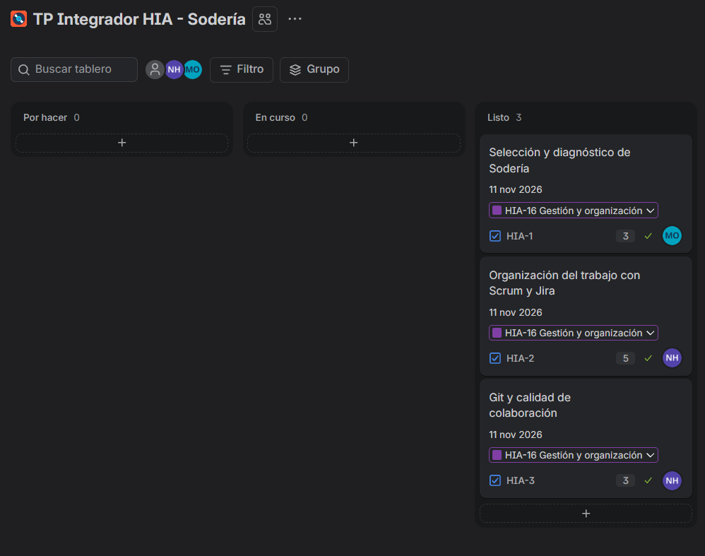
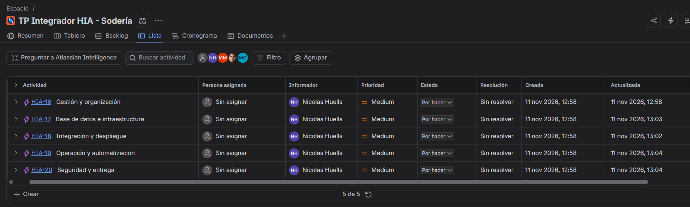
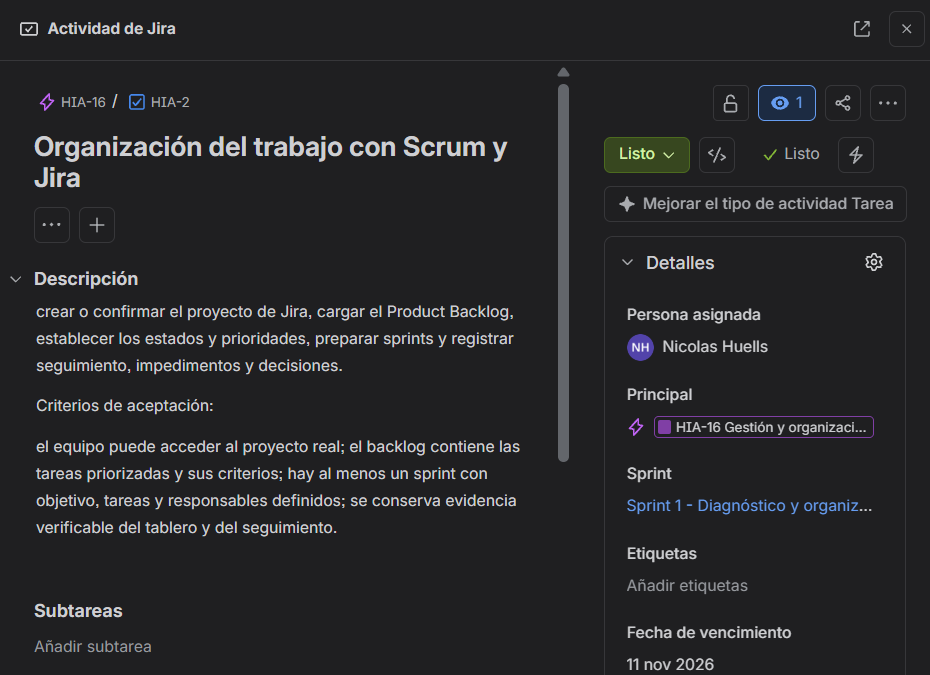
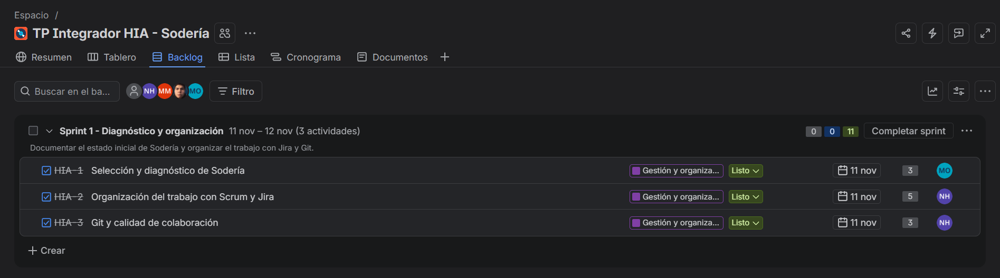
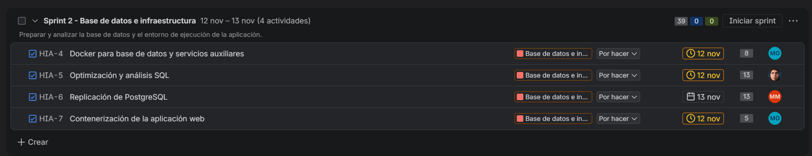
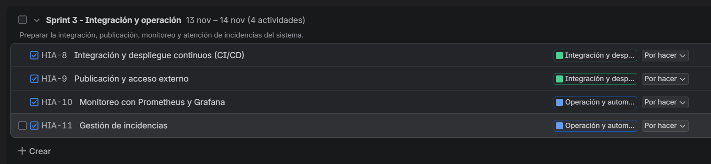
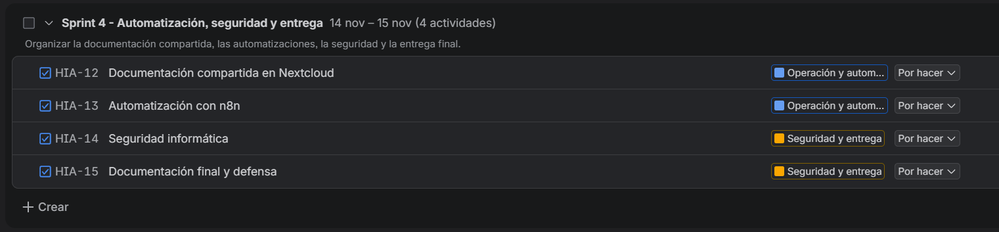

# 2. Gestión del proyecto mediante Scrum

## 2.1. Proyecto en Jira

El equipo organiza el TP Integrador de Sodería en el proyecto Scrum **TP Integrador HIA - Sodería** (clave **HIA**) de Jira Cloud. Scrum divide el trabajo en períodos breves llamados *sprints*: se planifican tareas, se sigue su estado y se revisa lo realizado para ajustar el trabajo siguiente. Jira permite ver el backlog, los responsables y el avance.

[Abrir el backlog del proyecto HIA en Jira](https://huellsnicolasr.atlassian.net/jira/software/projects/HIA/boards/2/backlog).

Las tareas **HIA-1 a HIA-15** ya están creadas. Las cinco épicas **HIA-16 a HIA-20** agrupan temas relacionados. Las actividades siguen siendo tareas técnicas. La información y las capturas de este documento reflejan el estado observado el **12/11/2026**; los cambios posteriores deberán registrarse en Jira.

## 2.2. Product Backlog

El backlog cubre los quince puntos de la consigna, incluidos aplicación, infraestructura, pruebas, seguridad, documentación y despliegue. Las prioridades y los criterios de aceptación están cargados en Jira. Este cuadro los resume para la entrega:

| Tarea | Actividad | Prioridad | Criterio de aceptación resumido |
| --- | --- | --- | --- |
| HIA-1 | Selección y diagnóstico | Alta | Diagnóstico documentado con arquitectura, tecnologías y límites comprobados. |
| HIA-2 | Scrum y Jira | Alta | Backlog, sprints, roles y evidencias de seguimiento disponibles. |
| HIA-3 | Git y colaboración | Alta | Flujo de ramas y revisiones de cambios documentados y usados. |
| HIA-4 | Base de datos y servicios en Docker | Alta | Compose, datos persistentes, carga de prueba, backup y restauración comprobados. |
| HIA-5 | Optimización SQL | Alta | Ocho consultas con planes y mediciones comparables antes y después. |
| HIA-6 | Replicación de PostgreSQL | Media | Réplica y prueba de sincronización, fallo y recuperación documentadas. |
| HIA-7 | Aplicación en Docker | Alta | Frontend, API y base funcionan juntos; configuración documentada. |
| HIA-8 | CI/CD | Alta | Pipeline ejecutado para verificar, construir y desplegar. |
| HIA-9 | Acceso externo | Alta | Acceso externo seguro demostrado y arquitectura documentada. |
| HIA-10 | Monitoreo | Media | Métricas, paneles y una alerta probada. |
| HIA-11 | Incidencias | Media | Incidencias reproducibles registradas y verificadas en la herramienta elegida. |
| HIA-12 | Nextcloud | Media | Documentación compartida con accesos y permisos comprobados. |
| HIA-13 | n8n | Media | Tres flujos funcionales documentados y probados. |
| HIA-14 | Seguridad | Alta | Riesgos, controles, pruebas y respuesta a incidentes documentados. |
| HIA-15 | Documentación y defensa | Alta | Entrega reunida y aportes técnicos explicables por los cinco integrantes. |

Las estimaciones de dificultad se guardaron en Jira como puntos de historia; no equivalen a horas. HIA-5, HIA-6 y HIA-14 tienen 13 puntos y conviene revisar si se dividen al planificarlas.

## 2.3. Equipo y responsables

| Integrante | Rol propuesto |
| --- | --- |
| Orellana, Cristian Maximiliano | Product Owner y dueño de Sodería |
| Huells, Nicolas Rafael | Scrum Master y encargado del punto 2 |
| Guari, Christian Rene | Desarrollador |
| Figueroa, Maximiliano Rubén Mariano | Desarrollador y coordinador general |
| Mendez, Marcos Antonio | Desarrollador |

Los cinco realizan aportes técnicos y deben comprender el sistema para la defensa individual. Al **12/11/2026**, HIA-1, HIA-4 y HIA-7 estaban asignadas a Orellana; HIA-2 y HIA-3 a Huells; HIA-5 a Figueroa; y HIA-6 a Mendez. **HIA-8 a HIA-15 seguían sin responsable**. El equipo prevé asignarlas un día antes del inicio de su sprint.

## 2.4. Plan de sprints

| Sprint | Objetivo | Tareas |
| --- | --- | --- |
| 1. Diagnóstico y organización | Conocer Sodería y organizar el trabajo. | HIA-1, HIA-2, HIA-3 |
| 2. Base de datos e infraestructura | Preparar la base, analizarla y completar los contenedores. | HIA-4, HIA-5, HIA-6, HIA-7 |
| 3. Integración y operación | Integrar, publicar, monitorear y atender incidencias. | HIA-8, HIA-9, HIA-10, HIA-11 |
| 4. Automatización, seguridad y entrega | Compartir documentación, automatizar, revisar seguridad y cerrar la entrega. | HIA-12, HIA-13, HIA-14, HIA-15 |

Los cuatro sprints y sus tareas figuran en Jira. Al 12/11, el primero estaba activo y los otros tres eran futuros. Las fechas de vencimiento de las tareas son plazos de planificación de esta simulación académica; no demuestran que el trabajo esté terminado.

## 2.5. Seguimiento y reuniones

El equipo actualizará el estado de cada tarea en Jira y agregará allí enlaces a entregables, avances e impedimentos cuando ocurran. Las decisiones que afecten prioridades o alcance se registrarán con fecha en la tarea correspondiente o en el registro de reuniones. Una tarea se considerará terminada cuando se pueda comprobar su criterio de aceptación.

Las actas están en [Registro de reuniones Scrum](02-reuniones-scrum.md). Las reuniones del **09 y 11/11/2026** fueron informadas como realizadas; el detalle de la segunda sigue pendiente de completar. Las del **13 y 15/11/2026** permanecen programadas. Las capturas del tablero muestran estados, pero no prueban por sí solas la realización de reuniones.

## 2.6. Evidencias

Las capturas del equipo muestran el proyecto, las épicas, una tarea con su criterio de aceptación y los cuatro sprints:

**Pendiente para cerrar el punto:** asignar HIA-8 a HIA-15 cuando corresponda, guardar evidencia posterior de cambios reales de estado y completar únicamente las actas de reuniones que efectivamente se realicen.
