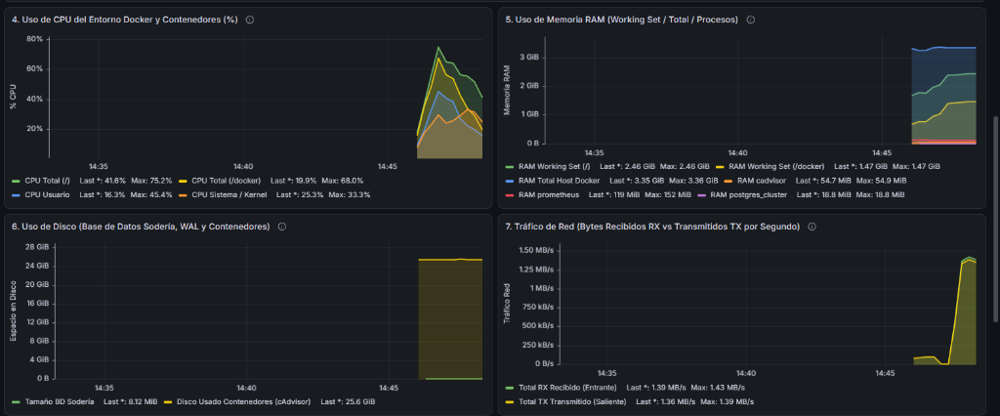
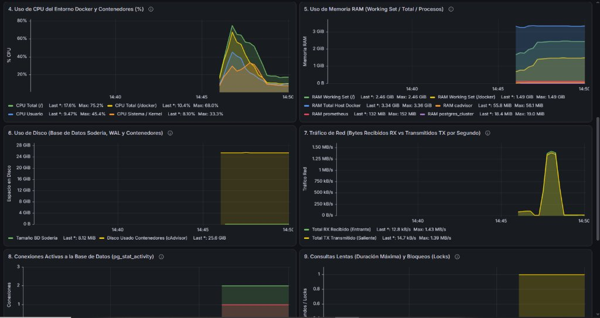

# Informe Técnico: Monitoreo y Observabilidad — Proyecto Sodería

## 1. Configuración de Prometheus

La recolección de métricas se centraliza en **Prometheus (`prometheus_server`)**, desplegado dentro de la red privada `soderia_red_cluster` sin exposición directa de puertos al exterior. Su configuración (`cluster/observabilidad/prometheus/prometheus.yml`) define cuatro *jobs* de extracción (*scraping*) con frecuencias diferenciadas según la criticidad del componente:

```yaml
global:
  scrape_interval: 15s

scrape_configs:
  - job_name: 'prometheus'
    static_configs:
      - targets: ['localhost:9090']

  - job_name: 'postgres_cluster'
    static_configs:
      - targets: ['postgres_exporter:9187']

  - job_name: 'cadvisor'
    static_configs:
      - targets: ['cadvisor_monitor:8080']

  - job_name: 'patroni_cluster'
    scrape_interval: 2s
    metrics_path: /metrics
    static_configs:
      - targets:
          - 'nodo1:8008'
          - 'nodo2:8008'
          - 'nodo3:8008'
```

### Arquitectura de Recolección (*Exporters*)
* **`patroni_cluster` (`:8008/metrics`):** Muestreo de alta frecuencia (**cada 2 segundos**) directamente contra la API REST de Patroni en los tres nodos para capturar cambios de rol (`patroni_primary`, `patroni_replica`), estado de replicación (`patroni_postgres_streaming`) y posiciones WAL.
* **`postgres_cluster` (`postgres_exporter:9187`):** Conectado a través de `haproxy:5432`, extrae métricas internas del motor PostgreSQL 17 sobre la base `soderia` (conexiones activas, transacciones por segundo, bloqueos y tamaño en disco).
* **`cadvisor` (`cadvisor_monitor:8080`):** Inspecciona el motor de contenedores Docker para obtener consumo de CPU, memoria RAM (*Working Set*), uso de disco y tráfico de red (RX/TX).

---

## 2. Dashboard de Grafana

La visualización se implementa mediante **Grafana (`grafana_dashboard`)** con aprovisionamiento automático (*provisioning* de *datasources* y tableros JSON v2 en `cluster/observabilidad/dashboards_json/`) y actualización en tiempo real cada **5 segundos**. Se estructuraron dos tableros complementarios:

1. **Tablero de Ciclo de Vida y Failover (`ciclo-vida-failover.json`):** Enfocado en la topología de alta disponibilidad, mapea el estado de cada nodo (`2 = Líder Azul`, `1 = Réplica Verde`, `0 = Caído Rojo`) y el historial de cambios de *Timeline*.
2. **Tablero de Observabilidad Integral (`observabilidad-integral.json`):** Compuesto por **12 paneles** que correlacionan infraestructura y motor SQL:
   * **Disponibilidad y Ciclo de Vida (Paneles 1, 2 y 3):** Estado `UP/DOWN` (`up`, `pg_up`), contador de reinicios en la última hora (`changes(patroni_postmaster_start_time[1h])`), eventos OOM y tiempo de actividad continuo (*Uptime* real).
   * **Recursos de Hardware y Red (Paneles 4, 5, 6 y 7):** Porcentaje de CPU (`container_cpu_usage_seconds_total`), memoria RAM (`container_memory_working_set_bytes`), espacio en disco (`pg_database_size_bytes`, `pg_wal_size_bytes`) y tráfico de red entrante/saliente (`RX/TX Bps`).
   * **Rendimiento de Base de Datos (Paneles 8, 9 y 10):** Conexiones activas (`pg_stat_database_numbackends`, `pg_stat_activity_count`), duración máxima de transacciones en curso (`pg_stat_activity_max_tx_duration`), bloqueos (`pg_locks_count`) y tasa de transacciones (`xact_commit`, `tup_fetched`, `tup_inserted`).
   * **Estado de Replicación (Paneles 11 y 12):** Estado de *streaming* por nodo y retraso de replicación en bytes (`patroni_xlog_received_location - patroni_xlog_replayed_location`).

---

## 3. Evidencia de Métricas Reales

Las siguientes evidencias confirman la captura efectiva de telemetría real tanto a nivel de API de Prometheus como en los paneles visuales de Grafana:

### 3.1. Validación por API de Prometheus
Consulta directa al endpoint de Prometheus verificando que los tres nodos del clúster reportan estado activo (`"1"`):

```bash
docker exec prometheus_server wget -qO- "http://localhost:9090/api/v1/query?query=up{job='patroni_cluster'}"
```

### 3.2. Telemetría Observada en Grafana (Capturas de Pantalla)
En las capturas del tablero **Observabilidad Integral** se evidencian las siguientes métricas reales en ejecución:
* **Panel 11 (Estado de Replicación Streaming):** Identifica a **`nodo3` como `PRIMARIO`** (tarjeta azul) y a **`nodo2` como `REPLICA`** (tarjeta verde en streaming activo).
* **Panel 12 (Lag de Replicación en Tiempo Real):** Muestra una línea plana en **`0 B` (0 Bytes)** tanto para `Lag nodo1`, `Lag nodo2`, `Lag nodo3` como para `WAL Diff (nodo2)`, confirmando sincronización inmediata sin pérdida ni retraso de datos.
* **Panel 3 (Tiempo de Actividad Continuo — Uptime Real):** Registra la curva ascendente continua de actividad de cada contenedor (`Servicio prometheus: 47.2 mins`, `Servicio cadvisor: 47.1 mins`, `Servicio postgres_cluster: 45.6 mins`, `Nodo nodo2: 21.1 mins`, `Nodo nodo3: 21.1 mins` y `Nodo nodo1: 7.63 mins`), permitiendo detectar al instante cualquier reinicio cuando una línea cae a `0 s`.
* **Paneles 4, 5, 6 y 7 (CPU, Memoria RAM, Disco y Tráfico de Red):** Registran el consumo real del entorno Docker oscilar entre **15 % y 20 % de CPU** (con picos de arranque de ~75 %), un uso estable de memoria RAM de **~3.3 GiB** totales (*Working Set* de 2.46 GiB), tamaño de la base `soderia` (`8.12 MiB` / `25.6 GiB` de contenedores) y tráfico de red entrante/saliente (`RX/TX` con pico de ~1.4 MB/s).
* **Paneles 8 y 9 (Conexiones Activas y Consultas Lentas / Locks):** Muestran las sesiones activas en `pg_stat_activity` y el monitoreo de bloqueos y duración máxima de transacciones.





---

## 4. Alertas y Umbrales Visuales Configurados

Para identificar anomalías de forma inmediata sin depender de inspección manual de logs, se configuraron reglas de umbral (*Thresholds*) y mapeos de estado críticos en los paneles de Grafana (y compatibles con reglas de evaluación en Prometheus):

| Condición Monitoreada | Expresión PromQL | Umbral / Condición de Alerta | Acción Visual / Estado |
| :--- | :--- | :--- | :--- |
| **Caída de Nodo o Servicio** | `up{job="patroni_cluster"} == 0` o `pg_up == 0` | Valor igual a `0` (`DOWN`) | Tarjeta en **Rojo (`🔥 CAÍDO`)** en Panel 1 y Panel 11. |
| **Reinicios Inesperados / OOM** | `changes(patroni_postmaster_start_time[1h]) > 0` | `>= 1` reinicio en 1h (`>= 3` crítico) | Cambio de color a **Naranja / Rojo** en Panel 2. |
| **Retraso de Replicación (Lag)** | `patroni_xlog_received_location - patroni_xlog_replayed_location` | Mayor a `0 Bytes` sostenido | Desviación sobre la línea base `0 B` en Panel 12. |
| **Saturación de Conexiones** | `pg_stat_database_numbackends{datname="soderia"}` | Acercamiento a `pg_settings_max_connections` (`300`) | Pico ascendente en Panel 8. |
| **Consultas Lentas / Bloqueos** | `pg_stat_activity_max_tx_duration{datname="soderia"}` | Transacción activa `> 5s` o incremento de `pg_locks_count` | Pico de latencia en Panel 9. |

---

## 5. Prueba de Detección de una Condición Anormal

Se ejecutó una prueba de detección de anomalías deteniendo uno de los nodos del clúster (`postgres_nodo1`) para validar el tiempo de reacción del sistema de monitoreo y la precisión de los paneles:

### Secuencia de Detección Observada
1. **Condición Normal Previa:** Todos los servicios reportaban estado `ONLINE` (`1`), con `nodo3` como Primario y `nodo1`/`nodo2` como Réplicas sincronizadas (`Lag = 0 B`).
2. **Inyección de la Anomalía:** Se detuvo abruptamente el contenedor `postgres_nodo1` (`docker stop postgres_nodo1`).
3. **Detección en Prometheus y Grafana (en `< 5 segundos`):**
   * **Panel 1 (Disponibilidad):** El target `nodo1:8008` cambió inmediatamente de verde (`✅ ONLINE`) a **rojo (`🔥 CAÍDO`)** al fallar el *scrape* de 2 segundos de Prometheus (evidenciado en el borde superior izquierdo de la captura).
   * **Panel 11 (Replicación Streaming):** `nodo1` desapareció de los nodos activos en streaming, manteniendo visibles únicamente a `nodo3` (`PRIMARIO`) y `nodo2` (`REPLICA`).
   * **Panel 3 (Uptime Real):** Al reincorporar posteriormente el contenedor (`docker start postgres_nodo1`), el gráfico registró el reinicio de su contador de tiempo activo desde `0 s` (mostrando `7.63 mins` de actividad frente a los `21.1 mins` de `nodo2` y `nodo3` que permanecieron encendidos sin interrupción).